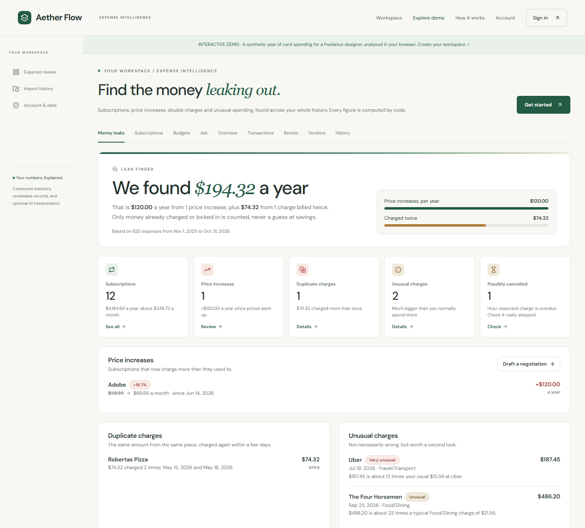
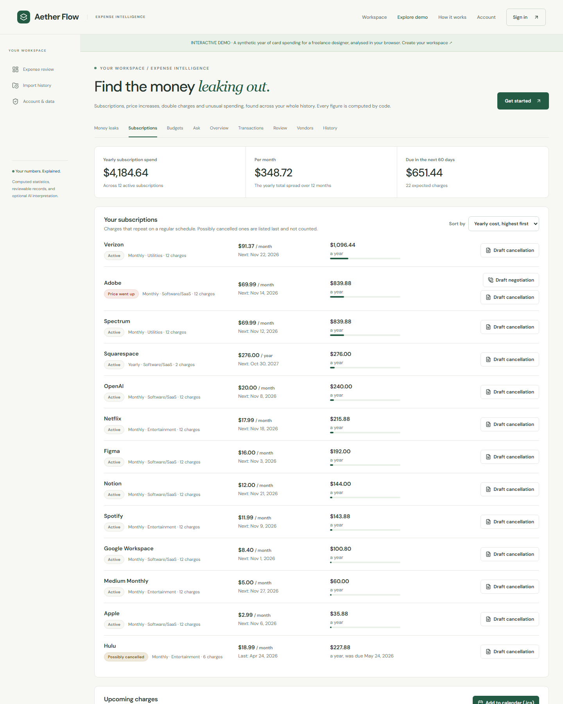
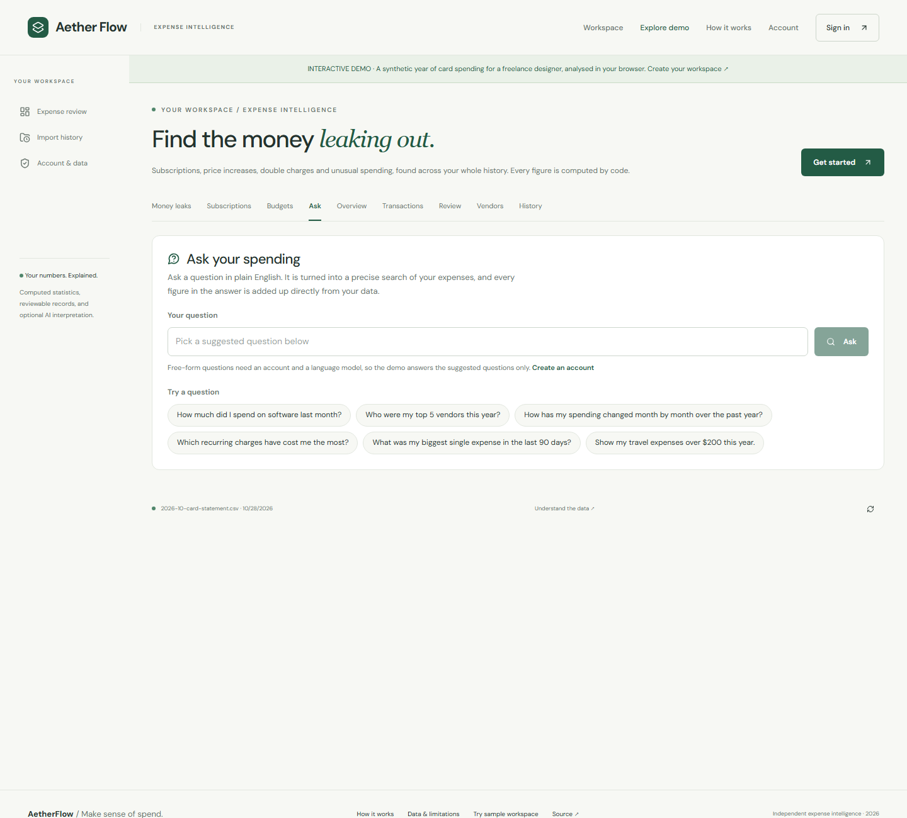
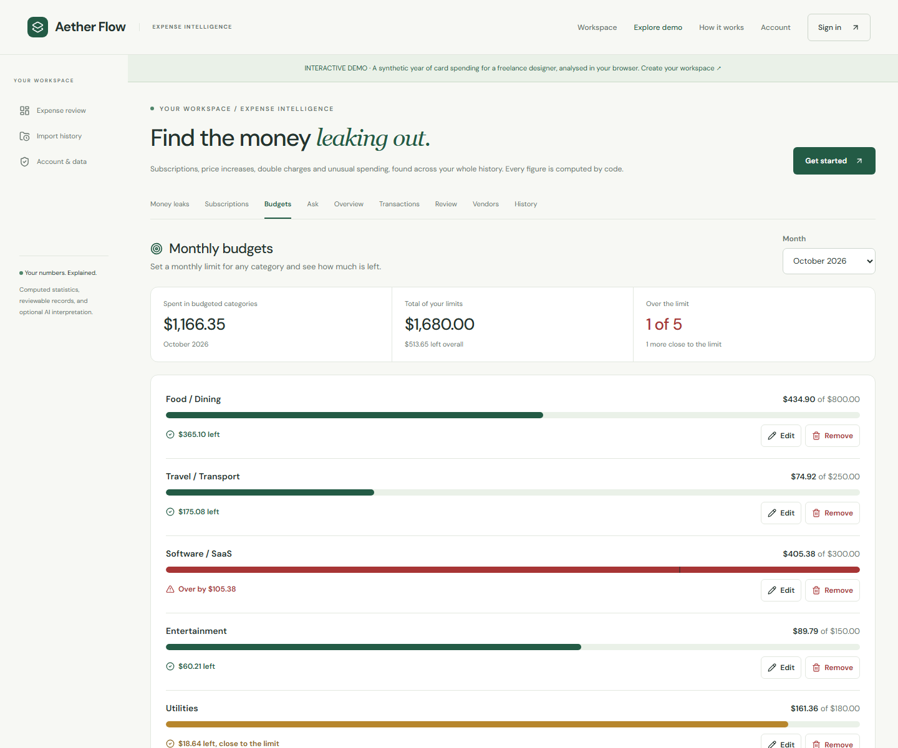
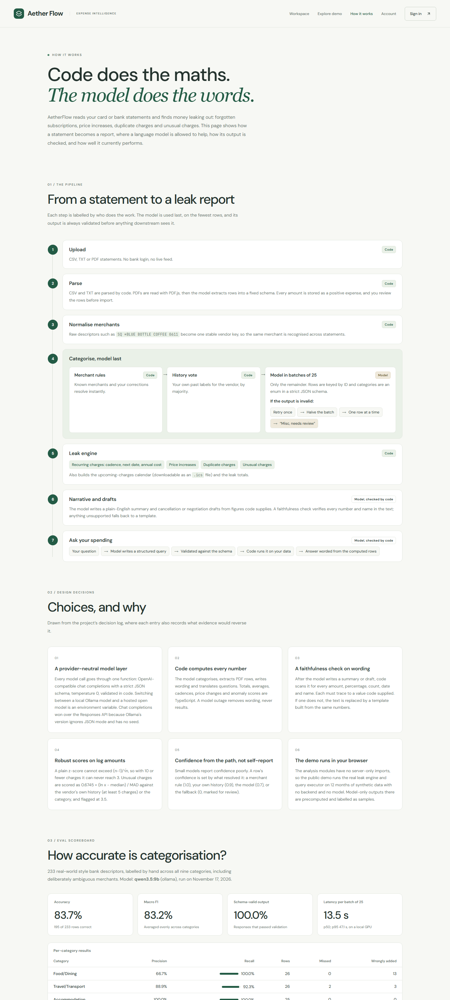

# Aether Flow

**Find the money leaking out of your accounts.** Aether Flow reads card and bank statements (CSV, TXT or PDF) and finds forgotten subscriptions, price increases, double charges and unusual spending. It then helps you act: an upcoming-charges calendar, cancellation and negotiation drafts, budgets, and plain-English questions about your spending.

**The rule that shapes the whole system: code computes every number, and the model only does the words.** A language model categorises merchants it doesn't recognise, extracts rows from PDFs, writes summaries and drafts, and translates questions into structured queries. Every figure on screen comes from deterministic, tested TypeScript, and model wording is checked against those figures before anyone sees it.



- **Demo, no sign-up:** `/demo` runs a full synthetic year in your browser with no backend and no model.
- **How it works:** `/how-it-works` is a public engineering page with the pipeline, the design decisions and the live eval scoreboard.
- **Production:** https://aetherflow-three.vercel.app serves the previous release until `feat/leak-finder` ships (see [Status](#status)).

## What it finds

On the demo year (620 synthetic transactions for a freelance designer, with leaks planted at known places), the engine finds exactly what was planted and nothing it shouldn't:

| Finding | Demo result | How it's detected |
| --- | --- | --- |
| Subscriptions | 12 active ($4,184.64 a year), plus Hulu flagged *possibly cancelled* | Per-merchant cadence from median intervals (weekly to annual), amounts within 15% or a persistent step change |
| Price increases | Adobe $59.99 → $69.99, **+$120 a year** | A step in a stream's amount that persists for two or more charges |
| Double charges | Same pizza order billed twice, **$74.32** | Same merchant and amount within 3 days, excluding expected recurring charges |
| Unusual charges | A $187.45 Uber ride and a $486.20 dinner | Robust score on log amounts against the merchant's own history, else a category range rule |
| **Headline** | **"We found $194.32 a year"** | Only money already charged or locked in counts, never a guess at savings |

Plus:
- an upcoming-charges calendar with `.ics` export;
- cancellation and negotiation drafts, with official cancel links for 42 services (28 URLs verified by hand);
- monthly budgets with month-end projection;
- tags and notes on transactions;
- "Ask your spending".

<table>
  <tr>
    <td></td>
    <td></td>
  </tr>
  <tr>
    <td></td>
    <td></td>
  </tr>
</table>

## Architecture

```text
 statement (CSV / TXT / PDF)
        │
        ▼
 parse ─────────────── code: CSV/TXT parsers; PDF.js text, then model row extraction
        │              into a fixed schema, every row reviewed by the user before import
        ▼
 normalise merchants ─ code: "SQ *BLUE BOTTLE 0611 NY" → vendor key "blue bottle"
        │
        ▼
 categorise ────────── 1. merchant rules (incl. the user's corrections)   confidence 1.0
        │              2. history vote (≥2 rows, ≥75% agree)              confidence 0.9
        │              3. model, batches of 25, ID-keyed enum schema      confidence 0.7
        │                 failure ladder: retry → halve batch → single → "Misc, needs review" (0)
        ▼
 leak engine ───────── code, pure and isomorphic: recurring streams, price changes,
        │              duplicates, unusual charges, RFC 5545 calendar
        ▼
 words ─────────────── model writes summary and drafts from code-supplied facts;
        │              faithfulness check: every amount, %, count, date and name must
        │              match the facts, otherwise regenerate once, then use a template
        ▼
 ask ───────────────── model: question → AskQuery JSON → validated → code executes →
                       answer worded from the computed rows
```

All model calls go through one function, `completeJson` in [`src/lib/llm/index.ts`](src/lib/llm/index.ts): OpenAI-compatible chat completions with a strict JSON schema, temperature 0 and validation in code. The provider is configuration, not code:

- local Ollama for development and evals;
- a hosted open model (Cloudflare Workers AI) for the live site;
- OpenAI if a key is supplied.

## Engineering decisions

Each one is recorded with its reasoning, and what would reverse it, in the [decision log](docs/leak-finder/03-decisions.md).

- **Model last, on the fewest rows.** Rules and the user's own history resolve known merchants first, and the model only sees what's left. Confidence is assigned by which path resolved a row, not by the model's own guess, because small models are poorly calibrated.
- **Robust scoring instead of plain z-scores.** With *n* charges a z-score can't exceed (n−1)/√n, so short histories never trigger. Unusual charges are scored as 0.6745 · (ln x − median) / MAD on log amounts. Categories that are lumpy by nature, such as travel and office equipment, are only judged against the merchant's own history.
- **A faithfulness check on every model sentence.** The narrative and drafts may only contain numbers and names present in the facts code supplied. Unsupported text is regenerated once, then replaced by a template, so a model failure removes wording, never correctness.
- **Questions become queries, not answers.** "Ask your spending" has the model emit a typed, schema-validated `AskQuery`; a pure executor computes the result. The model never sees the answer's numbers before code does.
- **Provider-neutral, chat completions.** Ollama's Responses endpoint ignores JSON mode and has no seed, so the system uses chat completions, which every target provider supports identically.
- **The demo runs the real code in the browser.** The analysis modules import nothing server-only, so `/demo` runs the production leak engine and query executor on a deterministic synthetic year.

## Measured results

Categorisation is scored by a harness (`npm run eval`) that runs the shipping categoriser over a **hand-labelled golden set of 233 raw bank descriptors**, covering all nine categories and including 83 deliberately hard cases.

| Run | Accuracy | Macro F1 | Valid JSON | Latency per 25 rows (p50 / p95) |
| --- | --- | --- | --- | --- |
| qwen3.5:9b on Ollama, laptop GPU (RTX 3080 Laptop, Vulkan), cold start | **83.7%** | 83.2% | 100% | 13.5 s / 47.1 s |

"Cold start" means no merchant rules and no history, so every row went to the model; that is the hardest case, a brand-new user. The main confusions are multi-purpose retailers (Amazon, Target, Costco) read as food, and marketing tools (Mailchimp, LinkedIn Premium) read as software. Full per-category results are on `/how-it-works` and in [`evals/results/latest.json`](evals/results/latest.json).

**Tests:** 669 tests across 49 files, covering:
- statistical fixtures, with planted positives and negatives for every leak detector;
- parsers, plus real PDF.js extraction;
- the failure ladder and faithfulness checker;
- routes with real Postgres row-level security through PGlite;
- component interaction tests for every view.

CI runs typecheck, lint, the full suite and `eval:ci`. `eval:ci` is an offline check of golden-set integrity, the merchant normaliser and the planted demo leaks, and needs no model or paid API.

## Run it locally

Requires Node 22.3 or later.

```bash
npm ci
npm run dev
```

Open http://localhost:3000/demo. The demo needs no database and no model.

For the signed-in app, copy `.env.example` to `.env.local` and fill in:

| Variable | Purpose |
| --- | --- |
| `NEXT_PUBLIC_SUPABASE_URL`, `NEXT_PUBLIC_SUPABASE_ANON_KEY` | Supabase project |
| `SUPABASE_SERVICE_ROLE_KEY` | Server only |
| `LLM_BASE_URL`, `LLM_API_KEY`, `LLM_MODEL` | Any OpenAI-compatible endpoint. Leave unset to use local Ollama |
| `LLM_MODEL_<TASK>` | Optional per-task model: `CATEGORIZE`, `EXTRACT`, `NARRATIVE`, `ASK`, `DRAFT` |

Apply the migrations in `supabase/migrations/` to an isolated database first.

To run the model locally, install [Ollama](https://ollama.com) and pull the model:

```bash
ollama pull qwen3.5:9b
```

On some NVIDIA laptop GPUs, Ollama's CUDA runner crashes on this model. Set `OLLAMA_LLM_LIBRARY=vulkan` and `OLLAMA_VULKAN=1`, then restart Ollama.

To check everything, run the evals, or score only the first 50 golden rows:

```bash
npm run verify
```

```bash
npm run eval
```

```bash
npm run eval -- --limit 50 --no-write
```

`npm run verify` runs the typecheck, lint, every test and the production build. `npm run eval` scores the configured model and records the run.

## Repository map

```text
src/lib/llm/                 provider-neutral model client (completeJson)
src/lib/expense-intel/
  normalize/                 merchant descriptor → display name and vendor key
  rules/  pass1/             rules, history vote, batched categoriser with failure ladder
  leaks/                     recurring, price changes, duplicates, unusual charges, .ics
  ai/  actions/              narrative, faithfulness check, drafts, cancel guide
  ask/                       AskQuery schema, translator, pure executor, answers
  budgets/                   budgets, tags and notes
src/lib/demo/                deterministic 12-month synthetic dataset with planted leaks
src/components/workspace/    workspace shell and views (leaks, subscriptions, budgets, ask)
src/app/                     Next.js routes, pages and API handlers
evals/                       golden set, harness, offline CI checks, recorded results
docs/leak-finder/            brief, architecture, workstreams, decisions, research
supabase/migrations/         database schema changes (applied manually)
```

## Documentation

- [Brief](docs/leak-finder/00-brief.md): scope, who it's for, and an honest market verdict.
- [Architecture](docs/leak-finder/01-architecture.md): pipeline, modules, model layer and demo mode.
- [Decision log](docs/leak-finder/03-decisions.md): each decision, its evidence, and what would reverse it.
- [Research](docs/leak-finder/04-research.md): evidence ledger with sources (competitors, models, methods).
- [Workstreams](docs/leak-finder/02-workstreams.md): how the build was split and accepted.
- [Release and verification runbook](docs/product-upgrade/02-release-and-verification.md): migrations, deployment, rollback.

## Status

`feat/leak-finder` is complete and verified locally: tests, lint, typecheck, production build, a recorded eval, and a browser review of every view. Before it goes live:

1. apply `supabase/migrations/20261116_leak_finder.sql` (tags, notes, budgets, merchant rules);
2. set the hosted model credentials;
3. merge and deploy.

**Limits:**
- Recurring detection needs two or three months of statements, and twelve for annual plans.
- Scanned PDFs need a provider with file input.
- Amounts are USD with no currency conversion.
- Insights are review prompts, not financial or tax advice.

## Stack

| Layer | Technologies |
| --- | --- |
| App | Next.js 16 (App Router), React 19, TypeScript, Recharts |
| Data | Supabase Postgres with row-level security |
| Models | Any OpenAI-compatible endpoint: Ollama (qwen3.5:9b), Cloudflare Workers AI, OpenAI |
| Quality | Vitest, Testing Library, PGlite, ESLint, GitHub Actions, golden-set evals |
| Hosting | Vercel |
